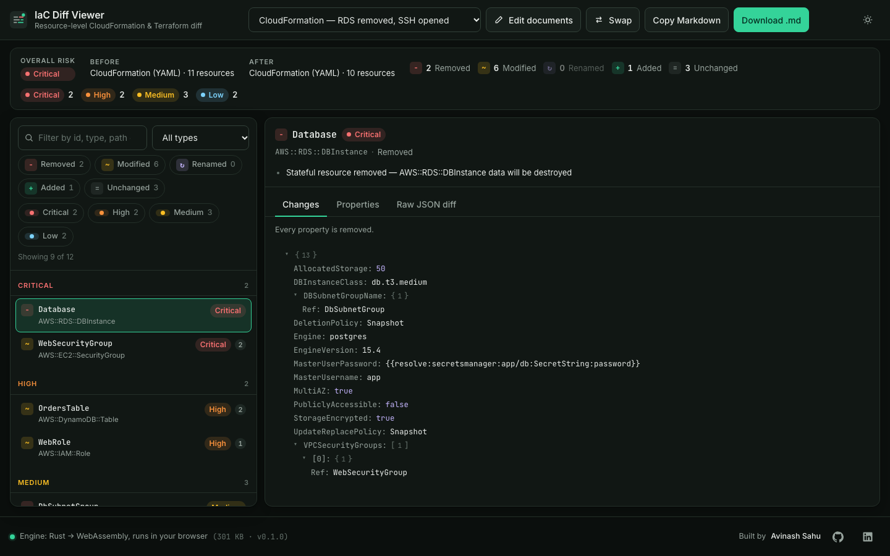

# IaC Diff Viewer

Semantic, resource-level diff for CloudFormation and Terraform documents, with every change tagged by risk. The diff engine is written in Rust and compiled to WebAssembly; nothing leaves your browser.

**Live demo:** https://avinash9694.github.io/iac-diff-viewer/



## Why I built this

I spend my days on a desktop app that scans AWS and Azure estates and proposes infrastructure changes, and the review step always came down to the same question: _of these forty lines of template diff, which three can actually hurt us?_ A textual diff cannot answer that — it does not know that `DeletionPolicy: Retain → Delete` on a DynamoDB table matters more than a renamed tag, or that a logical-id rename of an RDS instance is a destroy-and-recreate. This tool diffs at the level the cloud thinks in (resources and their properties) and applies the rules an experienced reviewer applies by hand. Writing the engine in Rust and shipping it as WASM was deliberate: the same crate can later run in a CLI, a CI step or a Tauri backend without a rewrite.

## Features

- **Three input formats, auto-detected**: CloudFormation templates (JSON or YAML, including `!Ref`, `!GetAtt`, `!Sub`, `!Join` short forms), `terraform show -json` plans (prior state diffed against planned values from a single file) and Terraform state files (`show -json` output or raw `tfstate` v4, child modules included).
- **Resource-level matching** by logical id / address, then a recursive property diff: objects by key, arrays by longest common subsequence so an inserted element does not cascade, and order-insensitive comparison for set-like fields (`Tags`, `SecurityGroupIds`, `ingress`, IAM `Statement`, …). Edited elements inside those sets are paired by identity (`Key`, `Sid`, protocol + port range) and diffed in place.
- **Rename / move detection**: a removed and an added resource of the same type with ≥ 0.9 Jaccard similarity over flattened leaves is reported as one rename, flagged High when the resource is stateful because the rename is really a replacement.
- **Risk tagging** (`Low` / `Medium` / `High` / `Critical`) with human-readable reasons — see the rule table below. Terraform plans that force a replacement of a stateful resource are Critical.
- **Review UI**: summary strip with counts and overall risk, resource list grouped by risk with `+ − ~ ↻` op chips, a detail pane with a changes table, a two-column before/after property tree with changed leaves highlighted, and a raw JSON diff tab. Filter by op, risk, type or free text; navigate with `↑ ↓ Home End`, `/` to search.
- **Markdown export** of the whole report (copy to clipboard or download).
- Dark-first theme following `prefers-color-scheme` with a persisted toggle, responsive from 360 px, keyboard-reachable everything, `aria-live` status for async work.
- **Structured errors, never panics**: malformed input comes back as `{ error, line, column, side }` and is shown next to the offending document.

## Architecture

```
┌──────────────────────────── browser ────────────────────────────┐
│  React 18 + TypeScript shell (Vite)                              │
│  TopBar · DocumentInputs · SummaryStrip · ResourceList · Detail  │
│        │ strings in              ▲ DiffReport (JSON) out         │
│        ▼                         │                               │
│  src/engine/engine.ts  — fetches iac_diff_bg.wasm once, wraps    │
│                          diff()/detect_document(), EngineError   │
│        │ wasm-bindgen + serde-wasm-bindgen                       │
│        ▼                                                         │
│  crates/iac-diff (Rust → wasm32-unknown-unknown, ~315 KB)        │
│    parse      text → serde_json::Value (YAML tag pass)           │
│    normalize  detect kind → Vec<Resource{id, kind, properties}>  │
│    propdiff   recursive diff, LCS arrays, set-like fields        │
│    rename     Jaccard pairing of removed/added                   │
│    risk       rule table → Risk + reasons                        │
│    engine     match by id, order, summarise → DiffReport         │
└──────────────────────────────────────────────────────────────────┘
```

**The Rust ↔ TypeScript boundary.** The crate exposes exactly two functions over `wasm-bindgen`: `diff(before, after)` and `detect_document(doc)`. Both take strings and return a `JsValue` produced by `serde-wasm-bindgen` in JSON-compatible mode, so the TypeScript side receives plain objects and arrays, typed by `src/engine/types.ts`, which mirrors `crates/iac-diff/src/model.rs` field for field. Errors cross the boundary as a serialised `DiffError` rather than a thrown panic; `engine.ts` rewraps that shape in an `EngineError` class with a `location` getter. The glue fetches the `.wasm` bytes by hand instead of letting the generated loader stream-compile them, which is what lets the footer report the exact engine size.

**Why WebAssembly.** The diff is CPU-bound and data-heavy (a plan for a mid-sized estate is megabytes of JSON), and I wanted it to run entirely client-side so templates and state — which contain account ids, ARNs and occasionally secrets — never touch a server. Rust gives a strict type system for the diff/risk model, `serde` for free (de)serialisation, and a single codebase that can also be used natively: `cargo test` runs the same 90+ tests that back the browser build, and the crate is an `rlib` as well as a `cdylib`.

### Risk rules

| Rule                                                                          | Risk     | Examples                                                                                                                    |
| ----------------------------------------------------------------------------- | -------- | --------------------------------------------------------------------------------------------------------------------------- |
| Stateful resource removed, or replaced (destroy + create) by a Terraform plan | Critical | `AWS::RDS::DBInstance`, `aws_s3_bucket`, `AWS::DynamoDB::Table`, `aws_sqs_queue`, ElastiCache, EFS, KMS keys, log groups, … |
| Security-group ingress widened                                                | Critical | new `0.0.0.0/0` or `::/0`, `FromPort`/`ToPort` range broadened, protocol → `-1`                                             |
| `DeletionPolicy` / `UpdateReplacePolicy` weakened                             | High     | `Retain → Snapshot`, `Snapshot → Delete`, policy removed                                                                    |
| IAM policy gains a wildcard                                                   | High     | `Action: "*"`, `s3:*`, `Resource: "*"` (ARN globs like `bucket/*` are fine)                                                 |
| Encryption turned off or KMS key removed                                      | High     | `StorageEncrypted true → false`, `SSEEnabled`, `kms_master_key_id` cleared, `BucketEncryption` block removed                |
| Public access enabled                                                         | High     | `PubliclyAccessible: true`, public-access-block flags switched off, `acl: public-read`, `MapPublicIpOnLaunch`               |
| Guardrail resource removed                                                    | High     | `aws_s3_bucket_public_access_block`, CloudTrail, GuardDuty, WAF ACL, backup plan                                            |
| Stateful resource renamed / moved without migration                           | High     | `aws_s3_bucket.assets → aws_s3_bucket.static_assets`                                                                        |
| Instance class / size changed                                                 | Medium   | `InstanceType`, `DBInstanceClass`, `node_type`, `AllocatedStorage`                                                          |
| Encryption downgraded from KMS to SSE-S3                                      | Medium   | `SSEAlgorithm: aws:kms → AES256`                                                                                            |
| Any other modification, or a stateless resource removed                       | Medium   | —                                                                                                                           |
| Tag-only change, new non-sensitive resource, stateless rename                 | Low      | —                                                                                                                           |

A resource takes the highest risk any rule assigns and keeps every reason, ordered by severity.

## Tech stack

- **Engine**: Rust (stable), `serde`, `serde_json`, `serde_yaml_ng`, `wasm-bindgen`, `serde-wasm-bindgen`, built with `wasm-pack --target web`
- **UI**: Vite 6, React 18, TypeScript (`strict`, `noUncheckedIndexedAccess`, `exactOptionalPropertyTypes`), CSS modules with design tokens on `:root`, Inter + JetBrains Mono
- **Quality**: `cargo test` / `clippy -D warnings` / `rustfmt`; Vitest + Testing Library against the real wasm build; ESLint flat config (typescript-eslint type-checked, react-hooks, jsx-a11y) at zero warnings; Prettier
- **Delivery**: GitHub Actions builds the wasm, runs every check and deploys to GitHub Pages

## Running locally

Prerequisites: Node 20+, Rust stable with the `wasm32-unknown-unknown` target, and `wasm-pack`.

```bash
rustup target add wasm32-unknown-unknown
cargo install wasm-pack --locked      # or: curl https://rustwasm.github.io/wasm-pack/installer/init.sh -sSf | sh

npm ci
npm run build:wasm                    # emits src/wasm/ (gitignored)
npm run dev                           # http://localhost:5173/iac-diff-viewer/
```

`npm run build` rebuilds the wasm and produces `dist/`. The three bundled samples are in `src/samples/`.

## Testing

```bash
cargo test                            # 91 unit tests: parsing, intrinsics, normalisation, LCS/set diff, renames, every risk rule
cargo clippy --all-targets -- -D warnings
cargo fmt --check
npm run build:wasm && npm test -- --run   # 24 Vitest tests, incl. a Testing Library smoke test of the full app
npm run lint && npm run typecheck && npm run format:check
```

## Project structure

```
crates/iac-diff/src/
  lib.rs        wasm-bindgen exports: diff, detect_document, version
  model.rs      Resource, ResourceDiff, PropertyChange, Risk, Summary, DiffError
  parse.rs      JSON/YAML → Value, CloudFormation intrinsic tag pass
  normalize.rs  format detection, CloudFormation / Terraform plan / state readers
  propdiff.rs   recursive property diff (LCS arrays, set-like fields)
  rename.rs     Jaccard similarity and rename pairing
  risk.rs       rule table
  engine.rs     orchestration and summary
src/
  engine/       wasm bridge (engine.ts) and the TS mirror of the model (types.ts)
  components/   TopBar, DocumentInputs, SummaryStrip, Filters, ResourceList, DetailPane, PropertyTree, Footer
  lib/          filters, markdown-report, line-diff, format, resource-key
  hooks/        useEngine, useTheme, useDebouncedValue
  samples/      bundled before/after fixtures
  test/         Vitest suites + setup that loads the real wasm in Node
.github/workflows/deploy.yml   Rust checks → wasm build → lint/typecheck/test/build → Pages
```

## Roadmap and known limitations

- Risk rules are heuristic and AWS-centric; Azure and GCP coverage is limited to a stateful-type list.
- CloudFormation conditions, `Fn::If` branches and nested stacks are diffed as literal values rather than evaluated.
- Terraform plans only see values known at plan time; attributes that are `(known after apply)` appear as unchanged or absent.
- Rename detection requires ≥ 0.9 property similarity; a rename combined with a large edit is reported as a remove plus an add.
- Possible next steps: a CLI wrapper around the same crate for CI gates, custom rule packs, and side-by-side source views with line mapping.

## License

MIT — see [LICENSE](LICENSE).
